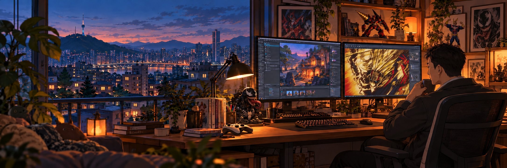

# Victor · NotNull92

### 오래 기억되는 게임과, 그 게임을 더 잘 만드는 도구를 만듭니다.

게임 개발자 · Unity / C# · Godot · AI 개발 도구 
서울, 대한민국

[이메일 보내기](mailto:fatiger92@gmail.com) · [English](README.md) · [포트폴리오](https://portfolio-tui-ten.vercel.app/?direct) · [Ember Studio](https://github.com/NotNull92/NotNull92.github.io)

## 개발자 소개 · PROFILE

블루포션 게임즈와 Banco Games에서 **6년 이상 모바일 MMORPG를 개발하고 운영해 온 게임 개발자**입니다. 전투와 콘텐츠, 플레이어가 보는 화면, 서버 통신, 그리고 서비스 중에 생기는 문제를 고치는 일을 맡았습니다. **연 매출 400억 원 이상을 기록한 프로젝트의 개발에 참여**했습니다.

지금은 그 경험을 개인 게임과 공개 개발 도구로 넓히고 있습니다. **게임을 만드는 일, 만드는 과정을 개선하는 일, 운영에 필요한 기능을 만드는 일**을 함께 하고 있습니다.

**현재 (2026년 10월):** Monstel Android 플레이 피드백 반영 · Hera for Unity v0.3.23 · Hera coding agent 개발 프리뷰

**함께 일한 팀 · PARTY:** 블루포션 게임즈와 Banco Games에서 기획·아트·QA·서버·운영 담당자와 함께 기능을 만들어 실제 서비스에 넣었습니다. Hera와 WorkForge는 공개 저장소로 이슈와 풀 리퀘스트를 받고 있으며, WorkForge에는 2026년 8월 외부 기여자의 [macOS 대시보드 이식 (PR #4)](https://github.com/NotNull92/workforge-mcp/pull/4)을 병합했습니다.

 

| 플레이할 수 있게 | 믿고 쓸 수 있게 | 다음 작업이 쉬워지게 |
|:---|:---|:---|
| 게임 규칙을 조작, 전투, 보상, 이해하기 쉬운 화면으로 만듭니다. | 문제를 재현하고 수정한 뒤, 실제 실행 결과를 확인합니다. | 사람과 AI가 작업을 반복하고 결과를 확인할 수 있는 도구를 만듭니다. |

**팀에서 기여할 수 있는 일:** 게임 클라이언트 개발, 전투·콘텐츠·UI 구현, 에디터 도구, AI를 활용한 개발 과정 개선.

## 프로젝트 기록 · QUEST LOG

###  Monstel · 손님 한 명부터 자라는 괴물 호텔

같은 종족의 괴물 손님을 연결해 엘리베이터로 보내고, 프런트에서 숙박비를 받습니다. 번 돈으로 호텔을 넓히고 손님을 더 잘 맞이할 수 있게 개선해 나가는 게임입니다.

<strong>Godot / C#</strong>으로 호텔이 돌아가는 규칙부터 화면과 픽셀 아트까지 직접 만들고 있습니다. 지금은 **Android 플레이 피드백, 처음 하는 사람을 위한 안내, 난이도와 성장 속도 조정**을 다듬고 있습니다. 호텔 완공 보상까지 구현했고, 게임은 아직 개발 중입니다.

**이 프로젝트에서 하는 일:** 아이디어를 휴대폰에서 돌아가는 게임으로 만들고, 실제로 플레이하면서 불편한 부분을 다듬습니다.

 
개발 중 보관 화면 · 2026-10-26 자료 확인

비공개 소스 · 개발 중 · 최근 원격 작업: 2026년 10월 25일 · 같은 엔진을 위한 개발 도구 → <a href="https://github.com/NotNull92/hera-agent-godot">Hera for Godot</a>

###  Golem Sculptor · 퍼즐판 위에서 만드는 골렘 군대

떨어지는 돌을 쌓고 같은 색을 모으면 골렘이 됩니다. 골렘을 내보내 공격하거나 내 성벽을 지키게 할 수 있습니다. 더 모을지 지금 쓸지 고르는 것이 이 게임의 핵심 선택입니다.

퍼즐에서 한 선택이 전투로 이어지는 재미를 **브라우저 프로토타입**으로 실험하고 있습니다. 같은 돌 순서를 다시 재생할 수 있어 조정 전후를 같은 조건에서 비교할 수 있고, 최근에는 골렘 애니메이션과 아트를 넣었습니다.

**이 프로젝트에서 하는 일:** 핵심 재미를 먼저 확인하고, 게임 규칙과 화면 표현을 분리해서 개선합니다.

 
개발 중 보관 화면 · 2026-10-26 자료 확인

비공개 소스 · 프로토타입 · [공개 게임 소개](https://github.com/NotNull92/NotNull92.github.io/blob/main/assets/project-records.js)

<b>다른 게임 작업 · SIDE QUESTS</b>

**NoMoreRolls · Unity / C# 솔로 게임** 
같은 주사위 결과로 싸울 수도, 대화할 수도 있는 전투 게임입니다. 전투 흐름, 보상, 저장, 4개 언어 UI, 접근성 설정을 만들었습니다. 원격 저장소의 마지막 작업은 2026년 6월입니다.

**Inventoria · Unity / C# 프로토타입** 
가방에 아이템을 어떻게 놓느냐에 따라 전투가 달라지는 백팩 디펜스 RPG입니다. 인벤토리, 전투 계산, 성장, 저장을 만들었고, 2026년 8월에는 동료 고용을 추가하고 전투 속도와 글자 표시를 개선했습니다.

두 프로젝트의 소스는 비공개입니다. 같은 엔진을 위한 개발 도구 → [Hera for Unity](https://github.com/NotNull92/hera-agent-unity)

## 기술과 구현 경험 · SKILLS

게임 개발은 코드를 쓰는 데서 끝나지 않습니다. 실행되는지, 버튼이 눌리는지, 의도한 대로 움직이는지 누군가는 확인해야 합니다.

저는 AI 코딩 도구가 실제 게임 에디터 안에서 이 확인까지 직접 하도록 돕는 도구를 개발합니다. **할 일을 분명히 정하고, AI가 작업하게 한 뒤, 실행 결과로 확인하는 방식**입니다.

### [Hera for Unity](https://github.com/NotNull92/hera-agent-unity)

  

**AI가 Unity 프로젝트를 읽고, 고치고, 실행하고, 테스트할 수 있게 합니다.** 오류를 읽고, 씬을 바꾸고, 키보드와 마우스 입력을 시험하고, 결과 화면을 확인합니다. 개발자가 AI와 에디터 사이에서 결과를 일일이 전달하는 일이 줄어듭니다.

최근에는 지원되는 작업에서 수정한 파일만 저장하고, 삭제한 파일은 휴지통으로 보내고, 다음 작업에 필요한 명령 설명만 읽도록 개선했습니다.

Go + C# · [CLI v0.3.23 / Connector 0.2.13](https://github.com/NotNull92/hera-agent-unity/releases/tag/v0.3.23)

### [Hera for Godot](https://github.com/NotNull92/hera-agent-godot)

 

**AI가 실행 중인 Godot 에디터 안에서 게임을 만들고 확인합니다.** 씬과 오브젝트를 살펴보고 고치고, 코드를 실행하고, 플레이어 입력을 시험하고, 기대한 결과가 나왔는지 확인합니다.

 
데모 영상 썸네일이며 게임 실제 화면이 아닙니다 · [YouTube에서 보기](https://youtu.be/1YSc7_Q_Djc)

최신 버전은 불필요한 응답을 줄이고 관련 작업을 한 번에 묶어 처리합니다. AI가 마지막으로 읽은 뒤 대상이 바뀌었는지도 확인해서, 오래된 정보로 수정하는 일을 막습니다.

Go + GDScript / C# · [v2.1.0](https://github.com/NotNull92/hera-agent-godot/releases/tag/v2.1.0) · [게임 제작 데모](https://youtu.be/1YSc7_Q_Djc)

### [Hera coding agent](https://github.com/NotNull92/heraAgent)

 

**프로젝트를 읽고, 파일을 고치고, 검사를 실행하고, 이어서 대화하는 일을 한 화면에서 하는 터미널 앱**입니다. 설계 모드와 개발 모드를 나누고, 수정 전에 계획을 세우거나 이전 작업을 이어갈 수 있습니다.

최근에는 질문에 답하는 화면, 한국어·영어 사용 흐름, 긴 작업 기록을 읽는 스크롤을 개선했습니다. 지금은 **개발 프리뷰** 단계로, 소스는 공개되어 있지만 설치 패키지와 GitHub 릴리스는 아직 없습니다.

Codex App Server · 0.1.0-alpha.1

<b>AI와 함께 일하는 방식</b>

1. **결과를 정합니다.** 플레이어나 개발자에게 무엇이 달라져야 하는지 적습니다.
2. **현재 상태를 읽습니다.** 코드와 실제 에디터 상태를 확인합니다.
3. **필요한 부분을 고칩니다.** 다른 작업에 영향을 주지 않도록 변경 범위를 좁힙니다.
4. **실행합니다.** 컴파일, 테스트, 실제 조작, 화면 확인을 수행합니다.
5. **근거를 남깁니다.** 통과한 항목, 실패한 항목, 아직 확인하지 못한 부분을 구분합니다.

공개 저장소의 릴리스 노트, 테스트, 에디터 검증 기록은 각 실행에서 실제로 확인한 결과입니다.

## 운영과 도구 · WORKSHOP

### Ember Platform · 게임이 어떻게 운영되는지 볼 수 있게

게임에서 일어나는 일을 모으고, 이용 현황과 재방문 비율을 보고, 게임 설정을 원격으로 바꾸는 공통 서버입니다. 계정과 결제 확인 기능은 개발 중입니다.

최근에는 읽기 쉬운 보고서, 지표 다운로드, 날짜 기준을 맞춘 집계를 추가했습니다. **계정·결제 기능은 테스트 환경에서 검증하는 중입니다.**

비공개 소스 · Go / PostgreSQL / TypeScript · Unity·Godot 연동

### [WorkForge](https://github.com/NotNull92/workforge-mcp) · ChatGPT가 실제 프로젝트와 일하게

 

ChatGPT가 내 컴퓨터의 파일, 변경 기록, 이미지를 읽고, 확인을 거쳐 명령을 실행할 수 있게 연결합니다. 수정 전에는 파일이 처음 읽었을 때와 같은지 확인합니다. 연결과 업데이트는 별도 관리 화면에서 다룹니다.

[v0.2.9](https://github.com/NotNull92/workforge-mcp/releases/tag/v0.2.9) · macOS 소스 프리뷰 · 외부 기여 병합: [PR #4](https://github.com/NotNull92/workforge-mcp/pull/4)

| 일상에서 필요해서 만든 작은 도구 | 하는 일 |
|:---|:---|
| [Hebe for Unity](https://github.com/NotNull92/hebe-agent-unity) | 코드 실행, 테스트, 플레이 입력, 화면 캡처에 집중한 작은 Unity 도구입니다. |
| [Codex 사용량 트레이](https://github.com/NotNull92/codex-weekusage-tray) | Windows 작업 표시줄에서 남은 주간 사용량을 보여 줍니다. |
| [Claude 사용량 트레이](https://github.com/NotNull92/claude-weekusage-tray) | 다른 앱을 열지 않아도 남은 사용량과 초기화 시각을 볼 수 있습니다. |
| **여백** · 비공개 | 한글 초성으로 앱을 찾고, 즐겨찾기와 최근 앱을 이용하는 간결한 Android 런처입니다. |

## 화면 뒤의 사람 · OFF DUTY

**애니메이션, 만화, 게임, 웨이트 트레이닝**을 좋아합니다. 베놈, 그렌라간, 올마이트는 오랫동안 좋아해 온 작품이라 위 작업실 일러스트에도 소장품으로 넣었습니다. 마지막 화면이 꺼진 뒤에도 생각나는 게임을 만들고 싶고, 캐릭터와 연출만큼 게임이 안에서 어떻게 돌아가는지에도 관심이 많습니다.

**마음에 남는 캐릭터**

- **올마이트.** 다치고 피를 흘리면서도 웃는 얼굴로 사람들의 불안을 걷어내고, 평화의 상징으로서 쓰러지지 않습니다. 자신의 원점을 돌아보며 남을 위해 세상을 구하고, 힘을 잃은 뒤에도 윤리를 지키며 살아가는 모습에 감동받았습니다.
- **그렌라간의 시몬.** 보잘것없이 시작하고, 카미나를 잃고는 슬픔에 무너지는 인간적인 모습이 있습니다. 그 고난을 딛고 리더로 성장하는 과정, 그리고 나선력이 보여 주는 무엇이든 될 수 있고 해결할 수 있다는 가능성이 좋습니다. "내가 누구라고 생각하느냐"는 말로 자신의 원점을 되새기는 장면이 특히 기억에 남습니다.
- **베놈.** 안티히어로지만 자신만의 사연과 옳다고 믿는 정의가 있고, 자신이 지킬 수 있는 범위의 사람들을 지킵니다. 독특한 개성, 그리고 올마이트와도 통하는 유머와 강인함이 좋습니다.

지금은 **서울**에 살고 있고, 호주의 시드니, 브리즈번, 골드코스트, 클리블랜드에서도 살았습니다. **한국어가 모국어이고, 영어로 일상 대화가 가능합니다.**

> 게임을 만들고, 결과를 확인하고, 계속 개선합니다.

<b>기술 배경 자세히 보기</b>

| 분야 | 사용하는 기술과 경험 |
|:---|:---|
| 게임 개발 | Unity, C#, Godot, 전투·콘텐츠·UI, 저장, 다국어, 접근성 |
| 개발 도구 | Go, TypeScript, 에디터 자동화, CLI/TUI, MCP, Git / GitHub |
| 서버 | Go, PostgreSQL, 이벤트 수집, 지표, 원격 설정 |
| 기타 앱 | C++ / Win32 유틸리티, Kotlin Android 런처, React 포트폴리오 |

**게임과 개발 도구, 그리고 함께 만들 팀에 관해 이야기하고 싶습니다.**

[이메일 보내기](mailto:fatiger92@gmail.com) · [포트폴리오 소스](https://github.com/NotNull92/portfolio-tui) · [공개 프로젝트](https://github.com/NotNull92?tab=repositories)

프로젝트 현황 확인: 2026년 10월 26일 · 원격 저장소와 릴리스 기준 배너와 초상은 AI로 제작한 오리지널 일러스트이며, 실제 게임 화면이나 사진이 아닙니다.

