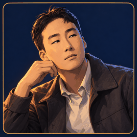
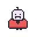
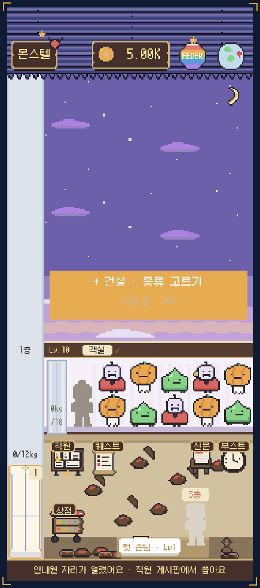
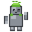
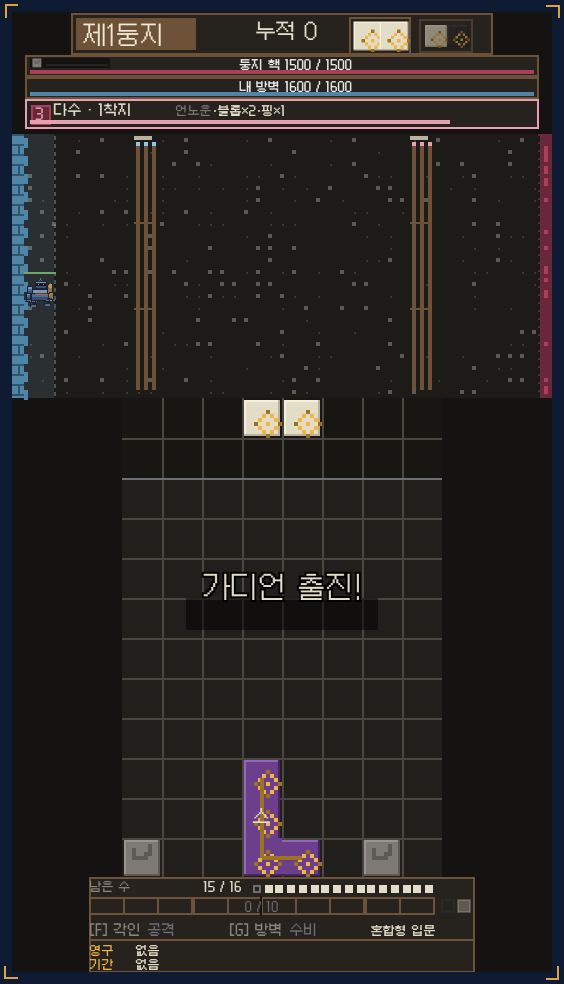
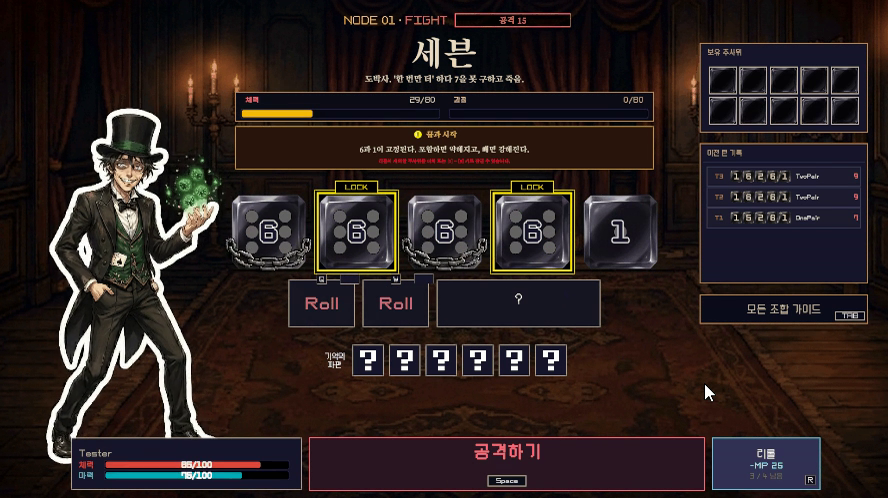
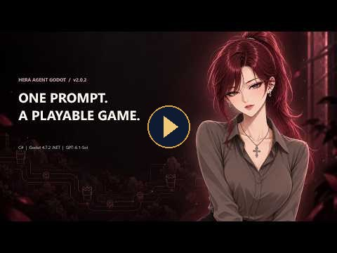

<picture>
  <source media="(prefers-reduced-motion: reduce)" srcset=".github/assets/studio-cover.jpg" />
  
</picture>

# Victor · NotNull92

### I build games people remember, and tools that help teams make them.

Game Developer · Unity / C# · Godot · AI Developer Tools 
Seoul, South Korea

[Email Victor](mailto:fatiger92@gmail.com) · [한국어](README.ko.md) · [Portfolio](https://portfolio-tui-ten.vercel.app/?direct) · [Ember Studio](https://github.com/NotNull92/NotNull92.github.io)

## About · PROFILE

I spent **6+ years building and running live-service mobile MMORPGs** at Bluepotion Games and Banco Games. I worked on gameplay, the screens players see, client-server communication, and fixes for games already in players' hands. The projects I contributed to generated **₩40B+ in annual revenue**.

Now I'm putting that experience into my own games and open-source developer tools. I work on the game itself, the tools used to make it, and the services that keep it running.

**Now (October 2026):** Monstel Android play feedback · Hera for Unity v0.3.23 · Hera coding agent development preview

**Working with others · PARTY:** At Bluepotion Games and Banco Games I worked with design, art, QA, backend, and operations teams to get features into a live service. Hera and WorkForge are public and take issues and pull requests. In August 2026 WorkForge merged an outside contributor's [macOS dashboard port (PR #4)](https://github.com/NotNull92/workforge-mcp/pull/4).

 

| Make it playable | Make it dependable | Make the next change easier |
|:---|:---|:---|
| Turn game rules into controls, combat, rewards, and clear screens. | Reproduce problems, fix them, and check the result in the running game. | Build tools so developers and AI can repeat the work and verify what changed. |

**Where I can contribute:** game client development, gameplay and UI systems, editor tools, and AI-assisted development workflows.

## Projects · QUEST LOG

###  Monstel · A monster hotel that grows with every guest

Match monster guests of the same kind, send them down the elevator, and collect their room fees at the front desk. The money goes back into expanding the hotel and running it better.

I'm building it in **Godot / C#**, from the hotel simulation and screens to the pixel art. Right now I'm working through **Android play feedback, first-time player guidance, and balance**. The hotel completion reward is in, and the game is still in development.

**What this shows:** carrying an idea all the way to a playable mobile game, then fixing the parts real players stumble on.

 
Archived in-development screen · Verified 2026-10-26

Private source · In development · Latest remote work: October 25, 2026 · Development tools for the same engine → <a href="https://github.com/NotNull92/hera-agent-godot">Hera for Godot</a>

###  Golem Sculptor · Build your army on a puzzle board

Stack falling stones, match colors, and decide when to turn them into golems. Golems can attack or defend your wall. The hard part is choosing when to spend what you have built up.

This **browser prototype** tests whether puzzle decisions carry over into combat in a way that feels good. Stone sequences can be replayed, so balance changes can be compared under identical conditions. Recent work added golem animation and art.

**What this shows:** checking a game's core idea early, and keeping the rules separate from the presentation.

 
Archived in-development screen · Verified 2026-10-26

Private source · Prototype · [Public game introductions](https://github.com/NotNull92/NotNull92.github.io/blob/main/assets/project-records.js)

###  NoMoreRolls · One roll, a choice between fighting and talking

Roll the dice, then choose whether to fight or talk. The same dice result can be used for either approach, so each turn asks you to decide how to face your opponent.

I'm building this solo project in **Unity / C#**. I implemented the combat flow, dialogue, rewards, saving, **UI support for Korean, English, Japanese, and Russian**, and accessibility settings. Recent work simplified collecting dice after battle and fixed inventory updates. The game is still in development.

**What this shows:** connecting game rules, dialogue, and player-facing screens into a playable flow, then making that flow easier to follow.

 
Archived in-development gameplay video frame · Verified 2026-10-26

Private source · In development · Latest remote work: June 2026 · Development tools for the same engine → <a href="https://github.com/NotNull92/hera-agent-unity">Hera for Unity</a>

<b>More game work · SIDE QUESTS</b>

**Inventoria · Unity / C# prototype** 
A backpack-defense RPG where how you arrange items changes how a battle plays out. I built the inventory, combat simulation, progression, and saving. In August 2026 I added companion hiring and improved battle pacing and text display.

Private source. Development tools for the same engine → [Hera for Unity](https://github.com/NotNull92/hera-agent-unity)

## Tools & Engineering · SKILLS

In game development, writing the code is only the first step. Someone still has to check that it compiles, that the button works, and that the game behaves as intended.

I build tools that let coding agents do those checks inside the real editor. **I give the AI a clear task, let it work, and ask for evidence of the result.**

### [Hera for Unity](https://github.com/NotNull92/hera-agent-unity)

  

**Lets an AI inspect, change, run, and test a Unity project.** It can read errors, work with scenes, try keyboard and mouse input, and capture what the game renders, so you spend less time carrying results between the agent and the editor.

Recent releases make edits safer: save only the edited asset where supported, move deleted assets to the trash, and read only the command details needed for the next task.

Go + C# · [CLI v0.3.23 / Connector 0.2.13](https://github.com/NotNull92/hera-agent-unity/releases/tag/v0.3.23)

### [Hera for Godot](https://github.com/NotNull92/hera-agent-godot)

 

**Lets an AI build and check a game in the live Godot editor.** It can inspect scenes, edit objects, run scripts, try player input, and check whether the expected result happened.

 
Demo video thumbnail, not an in-game screen · [Watch on YouTube](https://youtu.be/1YSc7_Q_Djc)

The latest release trims noisy output and groups related actions. It also notices when an object changed after the agent last read it, so the agent doesn't edit from a stale picture of the scene.

Go + GDScript / C# · [v2.1.0](https://github.com/NotNull92/hera-agent-godot/releases/tag/v2.1.0) · [Game-building demo](https://youtu.be/1YSc7_Q_Djc)

### [Hera coding agent](https://github.com/NotNull92/heraAgent)

 

**A terminal app that reads a project, edits files, runs checks, and keeps the conversation going in one place.** It has separate design and development modes, can plan before editing, and can pick up earlier work.

Recent work covers clearer questions, Korean and English interaction, and scrolling through long task histories. It is a **development preview**: the source is public, but there is no published package or GitHub release yet.

Codex App Server · 0.1.0-alpha.1

<b>How I work with AI</b>

1. **Define the result.** Describe what should change for the player or developer.
2. **Inspect the current project.** Read the code and check the editor's actual state.
3. **Make a focused change.** Keep unrelated work intact.
4. **Run it.** Compile, test, try the relevant interaction, and inspect the screen.
5. **Report the evidence.** State what passed, what failed, and what still needs checking.

Each repository has release notes, tests, and recorded editor checks from specific verification runs.

## Services & Utilities · WORKSHOP

### Ember Platform · See how a game is doing

A shared backend that collects game events, shows player activity and retention, and changes game settings remotely. Account and purchase verification are in development.

Recent work added clearer reports, downloadable metrics, and consistent reporting dates. **The account and purchase features are still being validated in a test environment.**

Private source · Go / PostgreSQL / TypeScript · Unity and Godot integration

### [WorkForge](https://github.com/NotNull92/workforge-mcp) · Let ChatGPT work with the real project

 

Connects ChatGPT to local files, Git history, images, and supervised shell commands. Before editing, it checks that the file hasn't changed since it was read. A local dashboard manages the connection and updates.

[v0.2.9](https://github.com/NotNull92/workforge-mcp/releases/tag/v0.2.9) · macOS source preview · External contribution merged: [PR #4](https://github.com/NotNull92/workforge-mcp/pull/4)

| Smaller tools for everyday annoyances | What they do |
|:---|:---|
| [Hebe for Unity](https://github.com/NotNull92/hebe-agent-unity) | A smaller Unity tool for running code, tests, player input, and screenshots. |
| [Codex usage tray](https://github.com/NotNull92/codex-weekusage-tray) | Shows the remaining weekly allowance in the Windows taskbar. |
| [Claude usage tray](https://github.com/NotNull92/claude-weekusage-tray) | Shows remaining usage and reset times without opening another app. |
| **Yeobaek** · Private | A minimal Android launcher that finds apps using Korean initial consonants, with favorites and recent apps. |

## Beyond the Screen · OFF DUTY

I like **anime, manga, games, and weight training**. I've been a Venom, Gurren Lagann, and All Might fan for years, which is why their collectibles ended up in the studio illustration above. I want to make games people still think about after the last screen fades, and I care as much about how a game works underneath as about its characters and presentation.

**Characters that stay with me**

- **All Might.** Even wounded and bleeding, he keeps smiling so people won't be afraid, and he refuses to fall while he is the Symbol of Peace. What moves me is how he keeps going back to where he started, saves the world without asking anything for himself, and goes on living by his principles after his power is gone.
- **Simon from Gurren Lagann.** He starts out as a nobody. When Kamina dies he falls apart, and that grief is what makes him human. He climbs out of it and grows into a leader, and Spiral Power carries the idea that you can become anything and get through anything. The line "Just who do you think I am?" is him reminding himself where he came from.
- **Venom.** An anti-hero with his own history and his own idea of what is right, who protects the people he can actually reach. I like how distinct he is as a character, and the humor and toughness he shares with All Might.

I live in **Seoul** and have also lived in Australia: Sydney, Brisbane, the Gold Coast, and Cleveland. **Korean is my first language, and I can hold a conversation in English.**

> Make the game. Measure the result. Keep improving.

<b>Technical background</b>

| Area | Tools and experience |
|:---|:---|
| Game development | Unity, C#, Godot, gameplay, UI, saving, localization, accessibility |
| Developer tools | Go, TypeScript, editor automation, CLI/TUI, MCP, Git / GitHub |
| Services | Go, PostgreSQL, event collection, reporting, remote settings |
| Other applications | C++ / Win32 utilities, Kotlin Android launcher, React portfolio |

**Let's talk about games, development tools, and the team building them.**

[Email Victor](mailto:fatiger92@gmail.com) · [Portfolio source](https://github.com/NotNull92/portfolio-tui) · [Public projects](https://github.com/NotNull92?tab=repositories)

Project status checked against remote repositories and releases on October 26, 2026. Cover and portrait: original AI-generated illustrations, not game screenshots or photographs.

